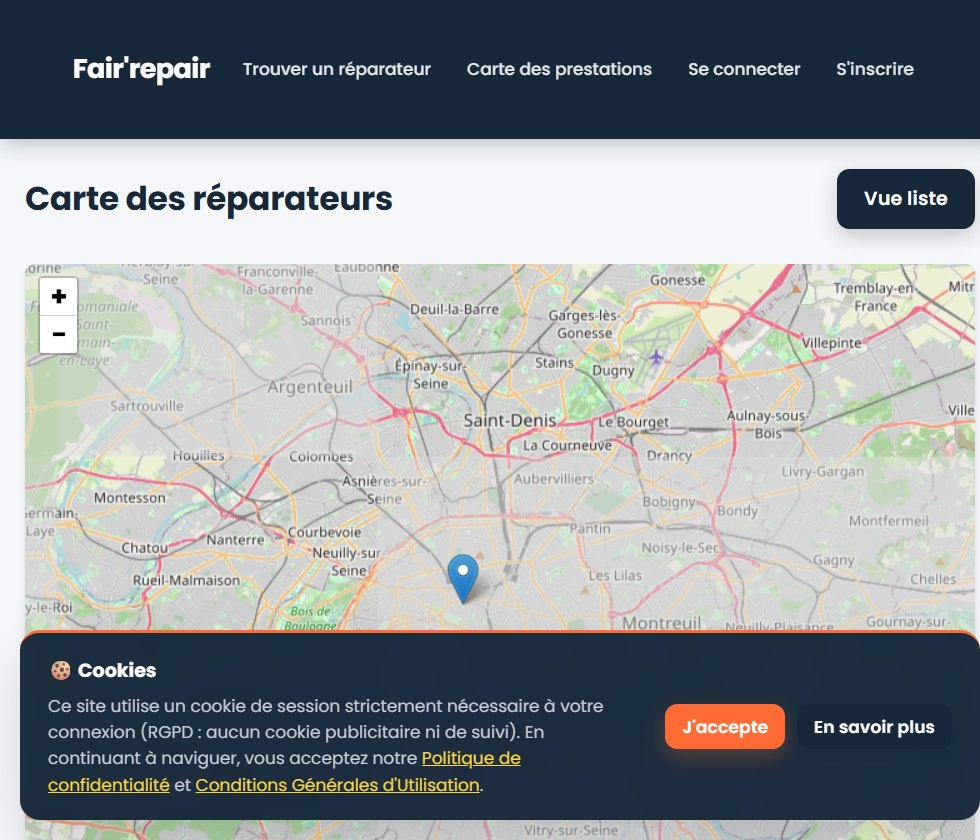

# Fair'repair

Plateforme qui met en relation des cyclistes avec des réparateurs de vélos : recherche,
carte interactive, réservation, avis et suivi des demandes.

Projet réalisé dans le cadre du **BTS SIO option SLAM** — PHP 8.2, MySQL, HTML/CSS/JS natif,
sans framework.



---

## Fonctionnalités

### Espace client
- Recherche par mot-clé et carte interactive (OpenStreetMap).
- Fiche réparateur, services proposés, réservation et suivi des demandes.
- Dépôt d'avis après prestation.
- Gestion du profil et des données personnelles : export JSON, suppression de compte,
  consentement RGPD, CGU et politique de confidentialité.

### Espace réparateur
- Tableau de bord, statistiques et graphique sur 6 mois.
- Gestion des services, des demandes reçues et des revenus.

### Espace administrateur
- Gestion des utilisateurs, signalements et verrouillages.
- Journal d'authentification et journal d'audit.

## Stack

| Élément | Choix |
|---|---|
| Langage | PHP 8.2 (PDO, sessions) |
| Base | MySQL — 12 tables |
| Front | HTML5, CSS3, JavaScript natif, Chart.js |
| Cartographie | OpenStreetMap |
| Dépendances | PHPMailer (uniquement pour l'envoi d'e-mails) |

## Sécurité

- Mots de passe hachés avec `password_hash` / `password_verify`.
- Requêtes préparées sur l'ensemble des accès à la base.
- Verrouillage du compte après 5 échecs de connexion.
- Journalisation des connexions et des actions d'administration.
- Vérification de propriété des ressources avant modification ou suppression.
- Échappement systématique des sorties (`htmlspecialchars`).

## Installation locale

1. Copier le dossier dans la racine web (AMPPS, XAMPP, WAMP…).
2. Créer la base `fair-repair` et importer `fair-repair.sql`.
3. Renseigner les identifiants dans `db.php`, ou définir les variables
   d'environnement `DB_HOST`, `DB_NAME`, `DB_USER`, `DB_PASS`.
4. Ouvrir `http://localhost/Fair_repair/`.

Le script `seed_demo.php` génère un jeu de données de démonstration.

### Comptes de démonstration

| Rôle | Identifiant | Mot de passe |
|---|---|---|
| Client | `camille.morel.26@demo.fairrepair.fr` | `Demo@Fair2026` |
| Réparateur | `lo.leroy.8@demo.fairrepair.fr` | `Demo@Fair2026` |
| Administrateur | `admin@demo.fairrepair.fr` | `Demo@Fair2026` |

Ces comptes et ces données sont fictifs et destinés à une base locale.

## Structure

```
Fair_repair/
├─ index.php              # accueil et recherche
├─ carte.php              # carte interactive
├─ services.php           # catalogue des services
├─ reserver.php           # réservation
├─ dashboard.php          # espace réparateur
├─ admin_*.php            # back-office
├─ mes_*.php              # espace client
├─ rgpd_consent.php       # consentement
├─ mes_donnees.php        # export / suppression (RGPD)
├─ fair-repair.sql        # schéma + données
├─ presentation/          # support de soutenance
└─ greenit_fairrepair/    # mesure Green IT
```

## Limites connues

- Pas de paiement en ligne : la réservation reste une mise en relation.
- Pas de tests automatisés.
- La carte dépend d'un accès réseau à OpenStreetMap.

## Auteur

**Rayane AKPO** — [github.com/rayanerakpo-blip](https://github.com/rayanerakpo-blip)
